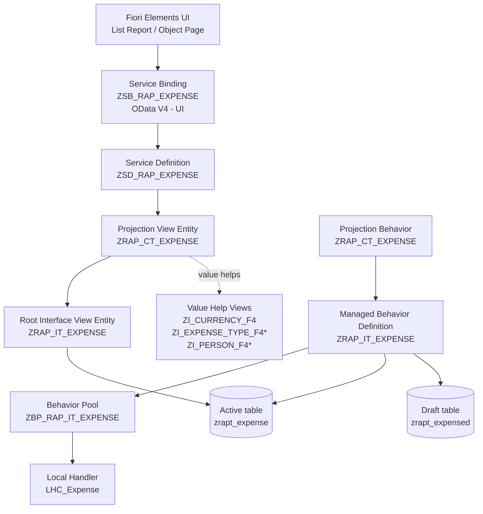

# SAP RAP Draft Application — Expense Management

A draft-enabled SAP RESTful Application Programming Model (RAP) application for maintaining employee expense records, built with ABAP CDS view entities, a managed RAP business object, OData V4, and a Fiori Elements UI.

> **Portfolio note:** This README is based on the ABAP/CDS text exports and screenshots present in the supplied ZIP. Some repository artifacts are represented only by screenshots, and the ZIP does not contain a complete ADT project export. Where implementation details cannot be verified, they are called out explicitly rather than assumed.

## Table of Contents

- [Project Overview](#project-overview)
- [Business Purpose and Rules](#business-purpose-and-rules)
- [Key Features Found in the Source](#key-features-found-in-the-source)
- [Fields and Data Model](#fields-and-data-model)
- [Technology Stack and Prerequisites](#technology-stack-and-prerequisites)
- [Architecture](#architecture)
- [Repository Structure](#repository-structure)
- [SAP Repository Objects](#sap-repository-objects)
- [CDS View Entities](#cds-view-entities)
- [Behavior Definition and Implementation](#behavior-definition-and-implementation)
- [Managed RAP and Draft Handling](#managed-rap-and-draft-handling)
- [Numbering and Key Generation](#numbering-and-key-generation)
- [Validations and Error Handling](#validations-and-error-handling)
- [Determinations](#determinations)
- [Side Effects and UI Refresh](#side-effects-and-ui-refresh)
- [Draft Lifecycle](#draft-lifecycle)
- [OData V4 Service and Fiori Elements](#odata-v4-service-and-fiori-elements)
- [Setup in ADT / Eclipse](#setup-in-adt--eclipse)
- [How to Run the Application](#how-to-run-the-application)
- [Test Scenarios](#test-scenarios)
- [Troubleshooting and Source Review Notes](#troubleshooting-and-source-review-notes)
- [Best Practices and Performance](#best-practices-and-performance)
- [Future Enhancements](#future-enhancements)
- [About the Author](#about-the-author)
- [Learning Resources](#learning-resources)
- [Implementation Gaps and Assumptions](#implementation-gaps-and-assumptions)

## Project Overview

This project demonstrates an expense-maintenance business object implemented with SAP RAP. Users can create, edit, and delete expense records through an OData V4 UI service. The behavior definition enables draft handling and defines validations and determinations for expense data.

The supplied service-binding screenshot identifies the binding as `ZSB_RAP_EXPENSE`, with binding type **OData V4 - UI**. It shows the service definition `ZSD_RAP_EXPENSE`, service version `1.0.0`, and the entity sets `Expense` and `ExpenseTotals`. The `ExpenseTotals` implementation is not included as a text source in the ZIP, so its fields and aggregation logic cannot be documented from source code here.

### Business purpose

The application provides a structured way to capture expense details such as date, type, amount, currency, description, and person/name. It demonstrates common RAP capabilities that are useful in business applications:

- Draft editing before changes are made active.
- Framework-managed UUID generation.
- Automatic assignment of an expense ID and system date.
- Derivation of a description from the expense type.
- Validation of a minimum expense amount.
- Validation intended to limit total expenses for a day.
- Value helps for expense type, currency, and person/name.
- Fiori Elements list/object-page presentation.

## Business Purpose and Rules

The following rules are visible in the supplied behavior implementation:

| Rule | Source behavior | Result |
|---|---|---|
| Minimum amount | `amount` validation on save for create/update | Amounts below `100` are rejected with an error message. |
| Daily total limit | `todaysExpense` validation on save for create/update | The method reports an error when its calculated total is greater than `10000`. See the important implementation caveat below. |
| Default date and expense ID | `defaultDate` determination on modify for create | Uses the system date and requests the next number from number-range object `ZNO_EXP_ID`, interval `01`. |
| Description derivation | `Desc` determination on modify when `expense_type` changes | Sets `expense_description` to the expense type followed by `-`. |
| UUID | Managed numbering in the behavior definition | RAP generates the UUID key. |

**Important:** The daily-total method currently selects from `zrap_expense_db`, while the active persistence defined in the behavior is `zrapt_expense`. The ZIP does not include a definition for `zrap_expense_db`. Therefore, the daily-total validation should be reviewed and tested in the target system before treating the daily limit as production-safe. The method also reads only the first entity instance from `keys`/the read result, which may not correctly validate multi-row requests.

## Key Features Found in the Source

- Managed RAP root business object `ZRAP_IT_EXPENSE`.
- Draft table `zrapt_expensed` and active table `zrapt_expense`.
- Projection entity `ZRAP_CT_EXPENSE`.
- Create, update, and delete operations.
- Draft actions: Activate, Discard, Edit, Resume, and Prepare.
- Managed UUID numbering.
- Number-range-based expense ID assignment using object `ZNO_EXP_ID`, interval `01`.
- Default expense date based on the system date.
- Expense description derived from expense type.
- Save-time amount validation and daily-total validation.
- Side effect from `expense_type` to `expense_description`.
- Value-help CDS entities for currency, expense type, and person/name.
- UI annotations for list columns, object-page identification, sorting, grouping, total amount, and selection fields.
- OData V4 UI service binding shown in a screenshot.

## Fields and Data Model

The active and draft table definitions contain the following business fields and technical fields.

| Field | Type / source | Meaning |
|---|---|---|
| `mandt` | Client field | Client dependency. |
| `uuid` | `SYSUUID_X16` | Technical key used by RAP; managed numbering is configured. |
| `expense_id` | `NUMC(10)` | User-facing expense identifier, assigned using a number range. |
| `expense_date` | `DATS` | Expense date; determination sets it to the system date on create. |
| `expense_type` | `CHAR(20)` | Expense category/type; value help is annotated in the metadata extension. |
| `expense_amount` | `DMBTR` | Expense amount; annotated with its currency reference. |
| `currency_code` | `WAERS` | Currency key. |
| `expense_description` | `STRING(256)` | Description derived by the `Desc` determination. |
| `name` | `CHAR(50)` | Person/name associated with the expense; value help is annotated. |
| `local_created_by` | `ABP_CREATION_USER` | Created-by audit field. |
| `local_created_at` | `ABP_CREATION_TSTMPL` | Creation timestamp. |
| `local_last_changed_by` | `ABP_LOCINST_LASTCHANGE_USER` | Last-change user for local instance changes. |
| `local_last_changed_at` | `ABP_LOCINST_LASTCHANGE_TSTMPL` | Local instance last-change timestamp. |
| `last_changed_at` | `ABP_LASTCHANGE_TSTMPL` | Last-change timestamp used as the ETag and total ETag. |
| `%admin` | `SYCH_BDL_DRAFT_ADMIN_INC` include | Draft administration data in the draft table only. |

The exact semantic labels and field layout in the UI are defined in `ZRAP_CT_ME_EXP.txt`.

## Technology Stack and Prerequisites

### Technology stack evidenced by the files

- ABAP Development Tools (ADT) in Eclipse.
- ABAP CDS view entities.
- SAP RAP managed implementation with draft.
- Behavior definitions and behavior handler methods.
- OData V4 UI service.
- Fiori Elements annotations and metadata extension.
- DDIC domain values for expense type and person/name.
- SAP currency data from `I_Currency`.
- Number range runtime API `CL_NUMBERRANGE_RUNTIME`.

### Prerequisites

Before importing or recreating this application, ensure that you have:

- Access to an ABAP system that supports the RAP syntax used by these sources. Confirm exact release compatibility in your own system.
- ADT/Eclipse connected to the relevant ABAP system.
- Authorization to create/activate tables, CDS entities, behavior definitions, behavior pools, service definitions, and service bindings.
- The required DDIC domains and number range object/interval configured.
- The required backend tables and CDS objects activated in dependency order.
- A system/client where the OData V4 UI service can be published and previewed.

The ZIP does not specify a precise SAP S/4HANA release or ABAP Platform support package. Do not infer a particular release solely from the source syntax.

## Architecture



`*` The ZIP filenames and definitions use `Zi_Expense_type_f4` and `zi_person_f4`, while the metadata extension refers to `ZI_EXPENSE_TYPE_F4` and `ZI_PERSON_F4`. ABAP object names are generally case-insensitive, but the exact repository object names must exist and activate in the target system.

## Repository Structure

The ZIP contains source exports and screenshots rather than a full ADT project with all dependency metadata.

```text
RAP Draft Application/
├── BO/
│   ├── ZRAP_CT_EXPENSE.txt
│   └── ZRAP_IT_EXPENSE.txt
├── BO_Class/
│   ├── ZBP_RAP_IT_EXPENSE.txt
│   └── Local_Class/
│       └── lhc_Expense.txt
├── Domains/
│   ├── ZDM_EXPENSE_TYPE.png
│   ├── ZDM_NO_EXP_ID.png
│   └── ZDM_PERSON_NM.png
├── HelpViews/
│   ├── ZI_CURRENCY_F4.txt
│   ├── Zi_Expense_type_f4.txt
│   └── zi_person_f4.txt
├── Interface_View/
│   └── ZRAP_IT_EXPENSE.txt
├── Metadata_Extension/
│   └── ZRAP_CT_ME_EXP.txt
├── Projection_View/
│   └── ZRAP_CT_EXPENSE.txt
├── Service_Binding/
│   └── SERVICE_BINDING.png
├── Service_Defination/
│   └── ZSD_RAP_EXPENSE.txt
├── Tables/
│   ├── zrapt_expense.txt
│   └── zrapt_expensed.txt
├── UI/
│   ├── Identification_Page_UI.png
│   └── Object_Page_UI.png
└── README.md
```

## SAP Repository Objects

| Object / artifact | Responsibility | Evidence in ZIP |
|---|---|---|
| `ZRAP_IT_EXPENSE` | Root interface CDS view entity over active persistence | `Interface_View/ZRAP_IT_EXPENSE.txt` |
| `ZRAP_CT_EXPENSE` | Transactional projection CDS view entity | `Projection_View/ZRAP_CT_EXPENSE.txt` |
| `ZRAP_IT_EXPENSE` behavior definition | Managed BO, draft, validations, determinations, side effects, locking, authorization, ETags | `BO/ZRAP_IT_EXPENSE.txt` |
| `ZRAP_CT_EXPENSE` projection behavior | Exposes operations and draft actions to projection | `BO/ZRAP_CT_EXPENSE.txt` |
| `ZBP_RAP_IT_EXPENSE` | Behavior pool class declaration | `BO_Class/ZBP_RAP_IT_EXPENSE.txt` |
| `LHC_Expense` | Local handler for determinations and validations | `BO_Class/Local_Class/lhc_Expense.txt` |
| `zrapt_expense` | Active persistence table | `Tables/zrapt_expense.txt` |
| `zrapt_expensed` | Draft persistence table | `Tables/zrapt_expensed.txt` |
| `ZRAP_CT_ME_EXP` | UI metadata extension | `Metadata_Extension/ZRAP_CT_ME_EXP.txt` |
| `ZI_CURRENCY_F4` | Currency value-help view over `I_Currency` | `HelpViews/ZI_CURRENCY_F4.txt` |
| `ZI_EXPENSE_TYPE_F4`* | Expense-type value-help view over `DD07T` | `HelpViews/Zi_Expense_type_f4.txt` |
| `ZI_PERSON_F4`* | Person/name value-help view over `DD07T` | `HelpViews/zi_person_f4.txt` |
| `ZSD_RAP_EXPENSE` | Service definition exposing `Expense` | `Service_Defination/ZSD_RAP_EXPENSE.txt` |
| `ZSB_RAP_EXPENSE` | OData V4 UI service binding | `Service_Binding/SERVICE_BINDING.png` |
| `ZDM_EXPENSE_TYPE` | Domain referenced by expense-type value help | Screenshot only |
| `ZDM_PERSON_NM` | Domain referenced by person/name value help | Screenshot only |
| `ZNO_EXP_ID` | Number range object referenced by ID determination | Source reference; configuration not supplied |
| `ExpenseTotals` | Entity set shown in service-binding screenshot | Source implementation not supplied |

`*` These names are inferred from the corresponding source file and the metadata extension reference. Confirm the exact active object names in ADT.

## CDS View Entities

### Root interface view entity — `ZRAP_IT_EXPENSE`

**Simple definition:** A CDS view entity is a reusable semantic data model over database tables or other entities. A root view entity represents the root of a RAP business object.

**Why it is used:** It provides the transactional BO's data model and connects the RAP behavior to active persistence.

**In this application:** It selects from `zrapt_expense`, exposes the expense fields and audit timestamps, and annotates `expense_amount` with `currency_code` as its currency reference.

```abap
define root view entity ZRAP_IT_EXPENSE
  as select from zrapt_expense
{
    key uuid,
        expense_id,
        expense_date,
        expense_type,
        @Semantics.amount.currencyCode: 'currency_code'
        expense_amount,
        currency_code,
        expense_description,
        name,
        local_created_by,
        local_created_at,
        local_last_changed_by,
        local_last_changed_at,
        last_changed_at
}
```

This excerpt is transcribed from the supplied source. The source has `@AccessControl.authorizationCheck: #NOT_REQUIRED`; this is a repository setting, not a substitute for application-level authorization design.

### Projection view entity — `ZRAP_CT_EXPENSE`

**Simple definition:** A projection is the consumer-facing layer that exposes the fields and operations needed by a particular UI or service.

**In this application:** It projects `ZRAP_IT_EXPENSE`, declares `provider contract transactional_query`, and allows metadata extensions. The projection is used by the service definition and Fiori Elements UI.

### Value-help view entities

| View | Source | Purpose |
|---|---|---|
| `ZI_CURRENCY_F4` | `I_Currency` | Supplies currency codes and currency names in the current session language. |
| `Zi_Expense_type_f4` | `DD07T` | Supplies active domain values/texts for `ZDM_EXPENSE_TYPE`. |
| `zi_person_f4` | `DD07T` | Supplies active domain values/texts for `ZDM_PERSON_NM`. |

The expense-type and person views filter domain texts by the session language and active status. Their labels are hidden in the value-help result, while the key value is exposed.

## Behavior Definition and Implementation

### Managed behavior definition

**Simple definition:** A behavior definition tells RAP which operations are allowed and how the business object is persisted and validated.

The interface behavior in `BO/ZRAP_IT_EXPENSE.txt` declares:

- `managed implementation in class zbp_rap_it_expense unique`
- `with draft`
- Active table `zrapt_expense`
- Draft table `zrapt_expensed`
- `lock master total etag last_changed_at`
- `authorization master ( instance )`
- `etag master last_changed_at`
- Create, update, and delete
- Read-only `uuid`, `expense_id`, and `expense_date` fields
- Managed UUID numbering
- `amount` and `todaysExpense` validations on save for create/update
- `Desc` and `defaultDate` determinations
- Side effect from `expense_type` to `expense_description`
- Draft actions Activate, Discard, Edit, Resume, and Prepare

### Behavior pool and handler

`ZBP_RAP_IT_EXPENSE` is the behavior pool class declaration. The actual business logic supplied in the ZIP is in local handler class `LHC_Expense`.

The local handler contains methods:

- `get_instance_authorizations`
- `defaultDate`
- `Desc`
- `amount`
- `todaysExpense`

The `get_instance_authorizations` method body is empty in the supplied source. Although the behavior definition declares instance authorization as master, the ZIP does not demonstrate authorization checks being implemented. Do not describe authorization as fully implemented until this method is completed and tested.

### Projection behavior

The projection behavior for `ZRAP_CT_EXPENSE` exposes create/update/delete and the draft actions to the projection consumer. The projection behavior uses `use draft` and `use side effects`.

## Managed RAP and Draft Handling

### Managed scenario

**Simple definition:** In a managed RAP scenario, the RAP framework handles standard persistence operations, while developers implement business-specific logic such as validations and determinations.

**Use here:** `ZRAP_IT_EXPENSE` is declared as managed and points to `zrapt_expense` for active records and `zrapt_expensed` for draft records.

### Draft-enabled business object

**Simple definition:** Draft lets a user edit an unfinished version of a record before making it active. Draft data is stored separately from active business data.

**Use here:** The behavior definition includes `with draft`, identifies the draft table, and exposes the standard draft actions. The draft table includes `%admin` via `sych_bdl_draft_admin_inc`.

Draft behavior at a high level:

1. A user creates a new expense or chooses Edit on an existing expense.
2. RAP maintains the in-progress data in the draft lifecycle.
3. The user can leave and resume a draft where supported by the UI/service.
4. Save/activation triggers the RAP save sequence and save-time validations.
5. If activation succeeds, the data becomes active.
6. Discard removes the unactivated changes rather than applying them to active business data.

The exact screens and messages depend on the published service and the generated Fiori Elements app.

### Locking and ETags

- `lock master` declares the root entity as the lock master.
- `total etag last_changed_at` is used for draft concurrency management.
- `etag master last_changed_at` supports optimistic concurrency checks on the active entity.

These declarations rely on the timestamp being maintained correctly by the framework and the persistence model.

## Numbering and Key Generation

Two identifiers are visible in the implementation:

- `uuid`: technical key; `field ( numbering : managed ) uuid` asks RAP to assign the UUID.
- `expense_id`: business-facing identifier; `defaultDate` calls `CL_NUMBERRANGE_RUNTIME=>NUMBER_GET` with number range object `ZNO_EXP_ID`, interval `01`, and quantity `1`.

The determination formats the number using `ALPHA = OUT` before assigning it to `expense_id`.

**Early numbering note:** The source calls the number range from the `defaultDate` determination declared `ON MODIFY` for create. This means number-range assignment is attempted during the modify phase rather than being implemented as a dedicated RAP `FOR NUMBERING` method. In RAP terminology, do not automatically equate this implementation with the formal early-numbering hook. Verify the intended numbering semantics and gaps/rollback behavior in your target release.

The ZIP does not include the number range object's configuration or a screenshot of its interval. Ensure `ZNO_EXP_ID` and interval `01` exist in the target system.

## Validations and Error Handling

A validation checks whether submitted data complies with a business rule. It should not be used to derive fields; derivation belongs in a determination.

### 1. Minimum expense amount — `amount`

| Item | Details |
|---|---|
| Trigger | `validation amount on save { create; update; }` |
| Method | `LHC_Expense=>amount` |
| Field | `Expense_Amount` / `expense_amount` |
| Rule | Amount must be at least `100`. |
| Pass behavior | No validation error is appended for this rule. |
| Fail behavior | The instance is added to `failed-expense`; an error message is reported against `Expense_Amount`. |
| Message | `Expense amount must be at least 100.` |

The method reads the requested entities in local mode and checks each returned expense amount. When an amount is below 100, it marks the entity as failed and reports an error severity message.

**Tests**

- Positive: create an expense for `100` or more; this rule should pass.
- Negative: create/update an expense for `99.99` or another amount below `100`; the save should be rejected with the message above.
- Boundary: test exactly `100` to verify the inclusive lower limit.

### 2. Daily total limit — `todaysExpense`

| Item | Details |
|---|---|
| Trigger | `validation todaysExpense on save { create; update; }` |
| Method | `LHC_Expense=>todaysExpense` |
| Field | `Expense_Amount` / `expense_amount`; date is `Expense_Date` |
| Intended rule | Total expense for the current system date must not exceed `10000`. |
| Fail condition in code | Calculated `lv_total_expense > 10000`. |
| Message | `Total expense for today cannot exceed 10000.` |

**Implementation caveats that must be fixed or verified:**

1. The SELECT reads `zrap_expense_db`, but the behavior definition declares `zrapt_expense` as active persistence. The former table is not defined in the ZIP.
2. The method reads only the first entity from the current request. Multi-instance requests may not be validated correctly.
3. The current draft's amount is added to the selected total, but update scenarios may need to subtract/exclude the previous active amount to avoid double-counting.
4. The total is filtered by current system date, not necessarily by the entity's `expense_date`.
5. The method reports `failed-expense` using `keys[ 1 ]`, which is unsafe if keys are empty and does not correctly identify all failing instances in a multi-row request.
6. Concurrent saves can exceed a limit unless the design accounts for transaction concurrency/locking.

Treat the rule as **present in source but requiring review** rather than as a verified production-safe control.

**Tests to run after correcting the implementation**

- Existing same-day total `9,000`; new amount `1,000`: expected total `10,000`, allowed.
- Existing same-day total `9,000`; new amount `1,001`: expected total `10,001`, rejected.
- Update an existing same-day expense without increasing the total: should not double-count the previous active value.
- Create several expenses in one request: each relevant instance should be accounted for.
- Create an expense dated in the past/future: confirm whether the business rule is based on system date or expense date.

### RAP messages and failed instances

`failed-expense` tells RAP which instance cannot be saved. `reported-expense` carries the message and field association so the consumer can show the error. The minimum-amount validation marks the amount field with `%element-Expense_Amount`. The daily-total validation similarly reports the amount field but uses the first key for the failed instance.

## Determinations

A determination derives or initializes data automatically. It is different from a validation: a determination changes data; a validation accepts or rejects data.

### 1. `defaultDate`

| Item | Details |
|---|---|
| Behavior declaration | `determination defaultDate on modify { create; }` |
| Handler method | `LHC_Expense=>defaultDate` |
| Trigger | On modify for create, as configured in the behavior definition |
| Fields changed | `expense_date`, `expense_id` |
| Logic | Reads the system date via `CL_ABAP_CONTEXT_INFO=>GET_SYSTEM_DATE`, requests a number from `ZNO_EXP_ID` interval `01`, formats it, then updates the entity in local mode. |

Example of intended result: a newly created record receives today's system date and a generated expense ID. The actual ID depends on the configured number range.

The implementation catches `CX_NR_OBJECT_NOT_FOUND` and `CX_NUMBER_RANGES`, but the catch blocks do not report an application message or otherwise handle the errors. Consider adding user-facing error reporting and handling for missing/exhausted intervals.

### 2. `Desc`

| Item | Details |
|---|---|
| Behavior declaration | `determination Desc on modify { field expense_type; }` |
| Handler method | `LHC_Expense=>Desc` |
| Trigger | When `expense_type` changes |
| Field changed | `expense_description` |
| Logic | Sets description to the expense type followed by a hyphen (`-`). |

Example: if `expense_type` is `TRAVEL`, the current source assigns `TRAVEL-` to `expense_description`. It does not derive a long descriptive text from the domain text; that would require additional logic.

### Side effects are not determinations

The `Desc` determination performs the actual update. The side-effect declaration tells the consumer that a change to `expense_type` can affect `expense_description`, so the UI may need to refresh/re-read the dependent value. Side effects do not enforce the business rule and do not replace the determination.

## Side Effects and UI Refresh

The interface behavior declares:

```abap
side effects
{
  field expense_type affects field expense_description;
}
```

- **Source field:** `expense_type`
- **Affected field:** `expense_description`
- **Why:** The description is derived when the expense type changes.
- **Expected UI behavior:** In a compatible Fiori Elements OData V4 UI, changing the type can cause the dependent description to be refreshed from the backend.
- **Business-rule enforcement:** The determination performs the assignment; the side effect communicates the dependency to the UI consumer.

The projection behavior includes `use side effects`. Confirm the behavior in the actual published UI; side-effect support and refresh timing can depend on the consumer and service metadata.

## Draft Lifecycle

| User action | RAP concept | Expected effect |
|---|---|---|
| Create | New transactional instance | User enters expense data; the create determination is configured to populate date and ID. |
| Edit | Draft action `Edit` | Existing active data is made available for draft editing. |
| Save / Activate | Draft action `Activate` and save sequence | RAP validates and activates the draft if no blocking errors occur. |
| Resume | Draft action `Resume` | Continues an existing draft where available. |
| Discard | Draft action `Discard` | Abandons unactivated draft changes. |
| Prepare | Draft determine action `Prepare` | Runs draft preparation behavior supported by the BO; the source does not include a custom Prepare handler. |

Active records reside in `zrapt_expense`; in-progress draft records are maintained in `zrapt_expensed`. Draft data is not the same as active business data. Do not query only the active table when trying to inspect an in-progress draft.

## OData V4 Service and Fiori Elements

### Service definition — `ZSD_RAP_EXPENSE`

The supplied source exposes the projection as `Expense`:

```abap
define service ZSD_RAP_EXPENSE {
  expose ZRAP_CT_EXPENSE as Expense;
}
```

### Service binding — `ZSB_RAP_EXPENSE`

The screenshot shows:

- Binding type: **OData V4 - UI**
- Service definition: `ZSD_RAP_EXPENSE`
- Version: `1.0.0`
- Service URL shown in the screenshot: `/sap/opu/odata4/sap/zsb_rap_expense/srvd/sap/zsd_rap_expense/0001/`
- Entity sets shown: `Expense` and `ExpenseTotals`
- Local service endpoint status: Published

The URL is documented as shown in the supplied screenshot; host, client, and authorization requirements depend on the target system. The `ExpenseTotals` entity is not defined in the provided text files, so this README does not claim how it is calculated or exposed in source.

### Metadata extension — `ZRAP_CT_ME_EXP`

The metadata extension contains:

- Header information with `Expense` / `Expenses` labels and `expense_id` as the title.
- Presentation variant sorting by `expense_date` descending and `expense_id` descending.
- Grouping by `expense_date`.
- Total on `expense_amount`.
- Line-item columns and object-page identification fields for expense ID, date, type, amount, currency, description, and name.
- Selection fields for expense ID and date.
- Value-help annotations for expense type, currency, and person/name.
- A hidden `uuid` field.
- A standard identification facet labelled `Expene Details` in the source (likely a label typo; the source is preserved as found).

The amount field is annotated with a currency reference in the CDS model, allowing consumers to interpret the amount with its currency code.

### Fiori Elements

**Simple definition:** Fiori Elements generates a standard UI from OData metadata and CDS/UI annotations, reducing the amount of custom UI code needed.

**Use here:** The metadata extension defines list-report columns, selection fields, sorting/grouping, totals, and object-page identification. The binding screenshot indicates a UI service binding intended for Fiori Elements preview.

The screenshots are visual evidence only; the ZIP does not include a generated UI project or launchpad configuration.

## Setup in ADT / Eclipse

The ZIP is a reference bundle of source text and screenshots, not an importable ABAP transport or complete ADT project. Use the following as a recreation/verification checklist.

1. Connect ADT to the target ABAP system and select the correct package.
2. Confirm or create the DDIC domains `ZDM_EXPENSE_TYPE` and `ZDM_PERSON_NM`.
3. Create/configure number range object `ZNO_EXP_ID` with interval `01`.
4. Create and activate active table `zrapt_expense`.
5. Create and activate draft table `zrapt_expensed`, including the draft admin include.
6. Create and activate `ZRAP_IT_EXPENSE`.
7. Create and activate the value-help entities `ZI_CURRENCY_F4`, `ZI_EXPENSE_TYPE_F4`, and `ZI_PERSON_F4`, verifying repository names and dependencies.
8. Create the managed behavior definition `ZRAP_IT_EXPENSE`.
9. Create the behavior pool `ZBP_RAP_IT_EXPENSE` and local handler implementation `LHC_Expense`.
10. Activate the behavior pool and behavior definition; resolve syntax/dependency errors in the target release.
11. Create and activate projection view `ZRAP_CT_EXPENSE`.
12. Create and activate projection behavior for `ZRAP_CT_EXPENSE`.
13. Create and activate metadata extension `ZRAP_CT_ME_EXP`.
14. Create and activate service definition `ZSD_RAP_EXPENSE`.
15. Create OData V4 UI service binding `ZSB_RAP_EXPENSE`, add the service definition, publish it, and open Preview.
16. Verify that the expected entity sets appear and test create/edit/activate/discard.
17. Correct the daily-total validation's persistence source and multi-instance/update handling before relying on it for business control.

Activate dependencies in the correct order for your system. Exact ADT wizard steps and available RAP syntax vary by ABAP release.

## How to Run the Application

1. Open service binding `ZSB_RAP_EXPENSE` in ADT.
2. Confirm the binding type is OData V4 - UI and the service definition `ZSD_RAP_EXPENSE` is assigned.
3. Publish the binding if it is not already published.
4. Choose **Preview** for the `Expense` entity set.
5. Create an expense and enter expense type, amount, currency, and name as appropriate.
6. Verify that `expense_date` and `expense_id` are populated by the determination.
7. Change `expense_type` and check whether `expense_description` updates to the type plus `-`.
8. Try an amount below `100` and verify the validation message.
9. Test daily-limit scenarios only after checking/fixing the `zrap_expense_db` reference and multi-instance logic.
10. Edit an existing expense and test draft resume, activation, and discard.
11. Verify that the active record is persisted in `zrapt_expense` after successful activation.

## Test Scenarios

These are **recommended tests**, not test results. The ZIP does not include automated test classes, execution logs, or evidence that these scenarios have been run.

| # | Scenario | Expected result based on source |
|---:|---|---|
| 1 | Create expense with amount `100` | Minimum-amount validation passes. |
| 2 | Create expense with amount below `100` | Save is blocked with `Expense amount must be at least 100.` |
| 3 | Create a new expense | `defaultDate` attempts to set system date and number-range expense ID. |
| 4 | Change expense type | `Desc` sets description to `<expense_type>-`; side effect declares the dependency. |
| 5 | Use currency value help | Currency help should offer codes from `I_Currency` if the CDS entity activates and is correctly referenced. |
| 6 | Use expense type help | Active domain values for `ZDM_EXPENSE_TYPE` should be offered, subject to exact object name and activation. |
| 7 | Use person/name help | Active domain values for `ZDM_PERSON_NM` should be offered, subject to exact object name and activation. |
| 8 | Daily total exactly `10000` | Intended to pass because the check is `> 10000`; validate after fixing data source and calculation logic. |
| 9 | Daily total above `10000` | Intended to fail with `Total expense for today cannot exceed 10000.`; validate after fixing implementation caveats. |
| 10 | Edit an active record and discard | Active record should remain unchanged; draft changes should be discarded. |
| 11 | Edit an active record and activate | Valid changes should become active after successful validation. |
| 12 | Submit multiple expenses in one request | Specifically test because current daily-total code only handles the first instance robustly. |

## Troubleshooting and Source Review Notes

### Service binding preview does not open

- Confirm the service definition and binding are active.
- Confirm the binding is published.
- Check user authorization, service URL, and backend error details.
- Re-activate dependent CDS entities and behavior definitions after changes.

### Value help is empty or activation fails

- Confirm the actual DDIC domain names and that active values exist.
- Confirm the CDS entity names match those used by `@Consumption.valueHelpDefinition`.
- Check `DD07T` language and `AS4LOCAL = 'A'` filters.
- Check that the target system supports the CDS annotations used.

### Expense ID is blank or numbering fails

- Verify number range object `ZNO_EXP_ID` and interval `01`.
- Check number-range configuration and authorization.
- Add explicit reported messages for the caught number-range exceptions.
- Confirm the determination is triggered in the intended create flow.

### Description does not refresh

- Verify that the `Desc` determination is active and that `expense_type` changes trigger it.
- Confirm projection behavior has `use side effects`.
- Inspect the OData V4 metadata and Fiori Elements behavior.
- Confirm `expense_description` is not read-only or otherwise overridden by UI configuration.

### Daily-total validation behaves unexpectedly

- The source references `zrap_expense_db`, not the configured active table `zrapt_expense`.
- The current code only considers the first current instance.
- Updates can double-count an existing active amount.
- The current system date is used for the total, rather than each record's expense date.
- Add robust handling for all keys and ensure the reported failure is tied to the correct instance.
- Consider transaction concurrency and locking if the limit is a financial control.

### Authorization appears not to be enforced

- `get_instance_authorizations` is empty.
- The behavior declaration `authorization master ( instance )` does not itself implement a business-specific check.
- Implement and test the required instance authorization logic before exposing the service broadly.

### Source naming mismatches

The metadata extension refers to `ZI_EXPENSE_TYPE_F4` and `ZI_PERSON_F4`; the source filenames use mixed-case names. ABAP repository identifiers are generally case-insensitive, but confirm the actual object names and references in ADT.

## Best Practices and Performance

- Keep the CDS interface, projection, behavior, and UI annotation responsibilities separate.
- Use validations for reject/allow decisions and determinations for field derivation.
- Use side effects to declare UI refresh dependencies, not to enforce business rules.
- Avoid `SELECT *`; select only the fields required.
- For aggregate validations, design explicitly for create, update, draft, and multi-instance requests.
- Do not rely on a single-instance implementation for bulk requests.
- Handle number-range exceptions with meaningful RAP messages.
- Implement actual authorization checks if instance authorization is declared.
- Keep active and draft persistence definitions aligned.
- Use ETags and locking consistently for concurrency-sensitive business objects.
- Verify OData V4 metadata and preview behavior after service changes.
- Add ABAP Unit tests for determinations and validations where the design allows it.
- Use ATC/ABAP Cloud checks and release-safe APIs for the target environment.

## Future Enhancements

These are recommendations, not features claimed as implemented:

- Correct and unit-test daily total calculation for create, update, multiple entities, and concurrent requests.
- Implement instance authorization in `get_instance_authorizations`.
- Report number-range errors to the consumer with RAP messages.
- Add automated ABAP Unit tests for the two validations and two determinations.
- Add explicit tests for draft activation, resume, and discard.
- Provide the source implementation for `ExpenseTotals` if the totals entity is part of the intended portfolio story.
- Add a full ADT project export or transport documentation so the repository can be recreated more reliably.
- Improve UI labels, including the source label `Expene Details`, if desired.
- Add API usage examples only after confirming the exact entity properties and service metadata in the running system.

## About the Author

**Nepal Singh Rajputh**  
**SAP ABAP Consultant | RAP | S/4HANA | CDS | AMDP | OData | REST APIs | Proxies | SAP Build Workflows | Adobe Forms & Smart Forms | Module Pool | Enhancements | Modern ABAP Syntax | BDC/BAPI | DDIC**

> Building modern SAP applications by combining strong ABAP fundamentals with RAP, CDS, Fiori Elements, and S/4HANA development.

My technical interests include modern ABAP development, SAP RAP business objects, CDS-based data modeling, OData services, S/4HANA application development, integration patterns, workflow automation, forms, enhancements, and robust enterprise application design.

This repository demonstrates practical learning and implementation of RAP draft handling, managed persistence, behavior definitions, validations, determinations, side effects, OData V4, and Fiori Elements annotations.

- Email: `[Add your email address]`
- LinkedIn: `[Add your LinkedIn profile URL]`
- GitHub: `[Add your GitHub profile URL]`

No contact details, certifications, or employment history are asserted here because they were not supplied for this README.

## Learning Resources

Use the official documentation that matches your target SAP release:

- [SAP Help Portal](https://help.sap.com/)
- [SAP ABAP RESTful Application Programming Model](https://help.sap.com/docs/abap-cloud/abap-rap/)
- [SAP ABAP Development Tools for Eclipse](https://tools.hana.ondemand.com/)
- [SAP Business Accelerator Hub](https://api.sap.com/)
- [SAP Community](https://community.sap.com/)

Consult the relevant release documentation for draft behavior, behavior definition syntax, OData V4 UI bindings, and ABAP Cloud API availability.

## Implementation Gaps and Assumptions

The following details could not be fully verified from the supplied ZIP:

1. **`ExpenseTotals`:** Appears in the service-binding screenshot but no CDS definition or service source for it is included.
2. **Service binding source:** Only a screenshot is provided; there is no editable service-binding artifact.
3. **DDIC domains and number range:** Domain screenshots are included, but complete export/configuration details and number range interval settings are not provided.
4. **Daily-total data source:** The method selects from `zrap_expense_db`, while the behavior's active table is `zrapt_expense`. No definition of `zrap_expense_db` is included.
5. **Authorization:** `get_instance_authorizations` is empty in the supplied handler source.
6. **Number-range exception handling:** Exceptions are caught but no RAP messages or recovery behavior are implemented in the shown code.
7. **Automated tests:** No ABAP Unit tests or test execution evidence are included.
8. **System release:** The ZIP does not identify the exact SAP S/4HANA or ABAP Platform release.
9. **Generated UI project:** Screenshots are present, but no separate Fiori/UI project source is included.
10. **Projection/value-help names:** The metadata extension references `ZI_EXPENSE_TYPE_F4` and `ZI_PERSON_F4`; confirm those exact repository objects exist and are active.

This README deliberately distinguishes what is directly evidenced in the source from recommendations and items requiring system verification.
